# Лабораторная работа № 6 «Система контроля версий»

## Содержание отчета
1. [Цель работы](#цель-работы)
2. [Порядок выполнения лабораторной работы](#порядок-выполнения-лабораторной-работы)
3. [Ход выполнения лабораторной работы](#ход-выполнения-лабораторной-работы)
4. [Лог команд](#лог-команд)
5. [История операций в форматированном виде](#история-операций-в-форматированном-виде)
6. [Вывод](#вывод)

---

## Цель работы
Изучение базовых возможностей системы контроля версий Git, получение опыта работы с локальным и удалённым репозиториями и платформой GitHub.

---

## Порядок выполнения лабораторной работы
1. Создать аккаунт на сайте GitHub.
2. Сделать копию в личное хранилище из
https://github.com/Kurtyanik/LR6/ (Fork).
3. Установить Git (https://git-scm.com/).
4. После установки настроить клиент git, введя имя пользователя (Группа
Фамилия И.О.) и email.
5. Клонировать свой личный удалённый репозиторий на компьютер.
6. Добавить файл через интерфейс GitHub. Подтянуть изменения в
локальный репозиторий.
Работу продолжать локально.
7. Получить историю операций для каждой из веток.
8. Просмотреть последние изменения.
9. Выполнить слияние в ветку master, разрешив конфликт (можно
использовать специальные редакторы или графический интерфейс git).
10. Удалить побочную ветку после успешного слияния.
11. Сделать изменения и зафиксировать их, оставляя комментарии,
несколько раз.
12. Сделать откат коммита.
13. Создать ветку для отчёта.
14. Начать оформлять отчёт в файле README.md (разрешены сторонние
редакторы с подсветкой синтаксиса), используя markdown синтаксис
(https://guides.github.com/features/mastering-markdown/):
В отчёте должен быть снимки экрана консоли и сторонних программ.
Файлы снимков экрана разместить в отдельной папке.
Лог команд (без результатов их выполнения).
При написании отчёта периодически делать коммиты, не забывать
комментировать.
15. Получить историю операций в форматированном виде (сокращённый
хэш + дата + имя автора + комментарий). Добавить её в отчёт и сделать
финальную фиксацию изменений.
16. Отправить локальные изменения в сетевое хранилище GitHub (если
делаете работу постепенно, то синхронизацию проводить в конце рабочего
сеанса)

---

## Ход выполнения лабораторной работы

### 1. Создание аккаунта

Для выполнения лабораторной работы был создан личный аккаунт на платформе GitHub.
> 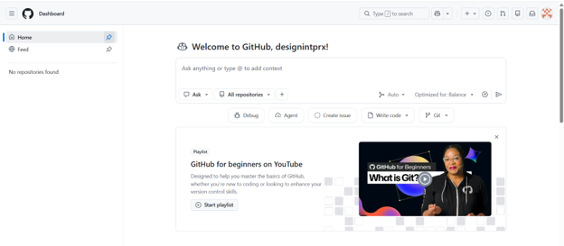
> *Рисунок 1 – Настройка пользователя и инициализация* 

### 2. Создание копии репозитория (Fork)
На платформе GitHub была сделана персональная копия исходного репозитория `Kurtyanik/LR6` с использованием функции Fork. Скопированный репозиторий сохранился в личном профиле для дальнейшей самостоятельной работы.

> 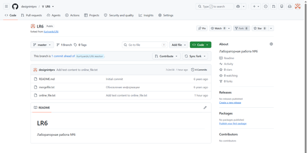  
> *Рисунок 2 – Личная копия репозитория на GitHub*

### 3. Установка Git
Для локального управления версиями с официального ресурса `git-scm.com` был загружен и установлен клиент Git. После завершения инсталляции корректность работы утилиты была проверена в терминале Git Bash.

> 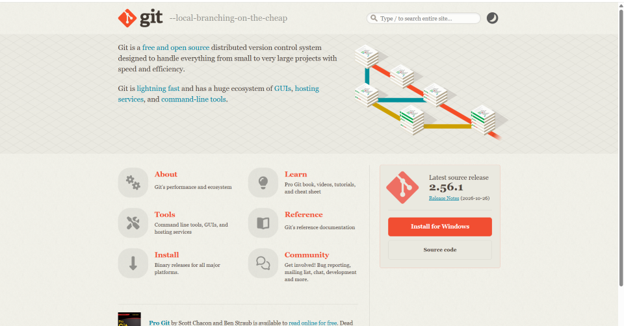  
> *Рисунок 3 – Официальный сайт клиент Git*

### 4. Настройка Git
После установки клиента через терминал были заданы глобальные параметры идентификации пользователя — имя с указанием номера группы (`4514 Тарасов`) и адрес электронной почты (`designintprx@gmail.com`). Настройка выполнялась с помощью утилиты `git config --global` для корректной подписи автора в журнале коммитов.

> 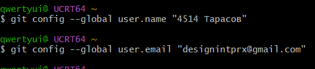  
> *Рисунок 4 – Настройка имени пользователя и электронной почты*

### 5. Клонирование репозитория на компьютер
Персональный удалённый репозиторий был скопирован на локальный диск с помощью команды `git clone`. Локальная рабочая копия проекта размещена в директории `Desktop/LR6` и привязана к удалённому хранилищу на GitHub.

> 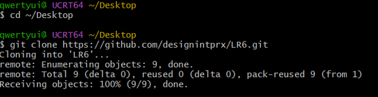  
> *Рисунок 5 – Локальная копия репозитория*

### 6. Добавление файла через GitHub и получение изменений
Непосредственно через веб-интерфейс GitHub в репозиторий был добавлен новый текстовый файл `online_file.txt` с тестовой записью (`тест из браузера`). Затем командой `git pull origin master` изменения были загружены в локальный репозиторий, после чего файл появился в папке проекта на компьютере.

> 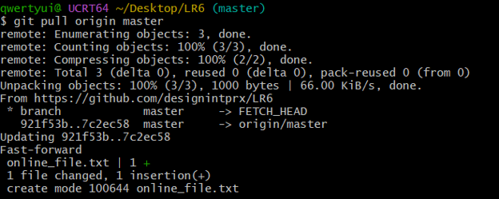  
> *Рисунок 6 – Проверка появления файла online_file.txt в локальном репозитории*

### 7. Получение истории операций для веток
Для анализа журнала фиксаций использовалась команда `git log --all --graph --oneline`. С её помощью был получен наглядный граф коммитов и проверена история изменений по веткам проекта.

> 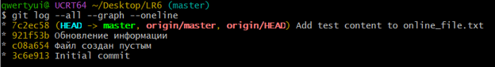  
> *Рисунок 7 – Просмотр истории операций в ветках*

### 8. Просмотр последних изменений
Для детального изучения последнего коммита в репозитории применялась команда `git show`. Она позволила просмотреть метаданные фиксации и конкретные построчные изменения в добавленном файле.

> 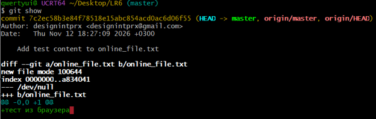  
> *Рисунок 8 – Просмотр последних изменений в репозитории*

### 9. Слияние веток и разрешение конфликта
При объединении ветки `branch1` с основной веткой `master` возник конфликт содержимого в файле `mergefile.txt`. Для его устранения файл был открыт в текстовом редакторе вручную: служебные маркеры конфликта были удалены, а нужные строки из обеих веток сохранены. После этого файл был добавлен в индекс (`git add`) и зафиксирован коммитом `Resolve merge conflict`.

> 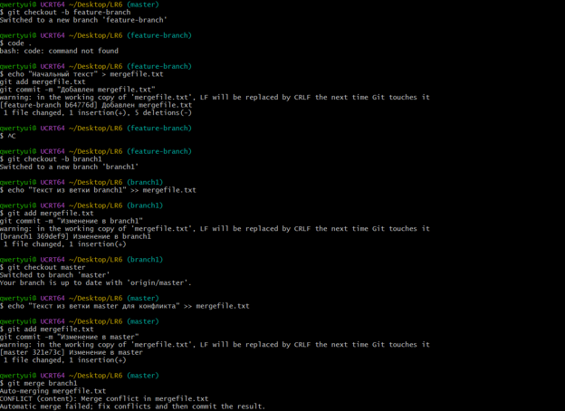  
> *Рисунок 9.1 – Ошибка конфликта слияния (CONFLICT) в терминале*
> 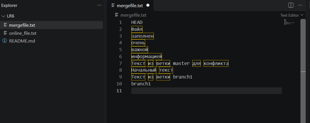  
  *Рисунок 9.2 – Редактирование файла и разрешение конфликта при слиянии веток*

### 10. Удаление побочной ветки
После успешного завершения слияния вспомогательная ветка `branch1` перестала быть актуальной и была удалена из локального репозитория с помощью команды `git branch -d branch1`.

> 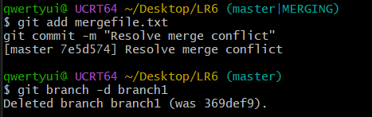  
> *Рисунок 10 – Удаление побочной ветки после слияния*

### 11. Внесение изменений и создание коммитов
В файл `mergefile.txt` было последовательно внесено несколько новых текстовых строк. Каждый отдельный этап правки фиксировался собственным коммитом с осмысленным комментарием для отслеживания прогресса работы.

> 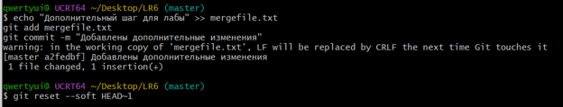  
> *Рисунок 11 – Фиксация изменений в репозитории и выполнение мягкого отката*

### 12. Откат коммита
Для отмены ошибочного временного коммита использовалась команда мягкого отката `git reset --soft HEAD~1` с последующим возвратом состояния файла через команду `git checkout -- mergefile.txt`. Это позволило скорректировать историю без потери нужных данных.

> 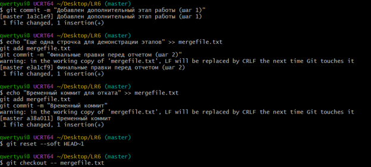  
> *Рисунок 12 – Серия коммитов, повторная фиксация и откат изменений*

### 13. Создание ветки для отчёта
Для подготовки и оформления отчётной документации была создана и выбрана отдельная ветка `Report` командой `git checkout -b Report`. Это позволило вести работу над отчётом изолированно от основной ветки `master`.

> 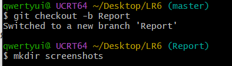  
> *Рисунок 13 – Создание и выбор ветки Report*

### 14. Оформление отчёта в README.md
Подготовка отчёта велась в файле `README.md` с применением разметки Markdown. Скриншоты выполнения работы сохранены в отдельную директорию `screenshots`, а в сам документ включён список выполненных консольных команд без вывода их результатов. Правки по ходу написания фиксировались коммитами.

> 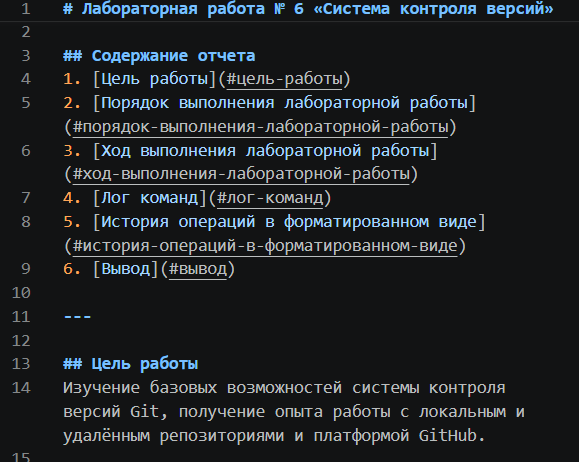  
> *Рисунок 14 – Оформление отчёта в файле README.md*

### 15. Получение истории операций в форматированном виде
Для вывода журнала коммитов в заданном формате (сокращённый хэш, дата, имя автора и комментарий) использовалась команда:
`git log --date=format:'%D' --pretty=format:"%h -> %cd, %cn (%s)"`

> 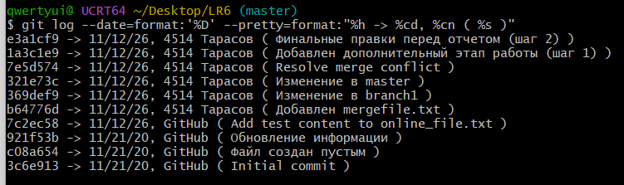  
> *Рисунок 15 – История операций в форматированном виде*

### 16. Отправка изменений в удалённый репозиторий
После завершения оформления отчёта и финальной фиксации локальные изменения были отправлены в сетевое хранилище на GitHub в ветку `Report` с помощью команды `git push origin Report`.


---

## Лог команд
```bash
git config --global user.name "4514 Тарасов"
git config --global user.email "designintprx@gmail.com"
git config --list
cd ~/Desktop
git clone https://github.com/designintprx/LR6.git
cd LR6
cd ~/Desktop
git clone https://github.com/designintprx/LR6.git
cd LR6
git pull origin master
git status
git log --all --graph --oneline
git show
git checkout -b feature-branch
code .
echo "Начальный текст" > mergefile.txt
git add mergefile.txt
git commit -m "Добавлен mergefile.txt"
git checkout -b branch1
echo "Текст из ветки branch1" >> mergefile.txt
git add mergefile.txt
git commit -m "Изменение в branch1"
git checkout master
echo "Текст из ветки master для конфликта" >> mergefile.txt
git add mergefile.txt
git commit -m "Изменение в master"
git merge branch1
git add mergefile.txt
git commit -m "Resolve merge conflict"
git branch -d branch1
echo "Дополнительный шаг для лабы" >> mergefile.txt
git add mergefile.txt
git commit -m "Добавлены дополнительные изменения"
git reset --soft HEAD~1
git checkout -b Report
mkdir screenshots
git checkout master
git commit -m "Добавлен дополнительный этап работы (шаг 1)"
echo "Ещё одна строчка для демонстрации этапов" >> mergefile.txt
git add mergefile.txt
git commit -m "Финальные правки перед отчетом (шаг 2)"
echo "Временный коммит для отката" >> mergefile.txt
git add mergefile.txt
git commit -m "Временный коммит"
git reset --soft HEAD~1
git checkout -- mergefile.txt
git log --date=format:'%D' --pretty=format:"%h -> %cd, %cn ( %s )"
```

## История операций в форматированном виде

Для получения истории коммитов с сокращённым хэшем, датой, именем автора и комментарием использовалась команда:

```bash
git log --all --pretty=format:"%h | %ad | %an | %s" --date=short
```

Результат выполнения команды:

```text
e3a1cf9 | 2026-11-12 | 4514 Тарасов | Финальные правки перед отчетом (шаг 2)
1a3c1e9 | 2026-11-12 | 4514 Тарасов | Добавлен дополнительный этап работы (шаг 1)
7e5d574 | 2026-11-12 | 4514 Тарасов | Resolve merge conflict
321e73c | 2026-11-12 | 4514 Тарасов | Изменение в master
369def9 | 2026-11-12 | 4514 Тарасов | Изменение в branch1
b64776d | 2026-11-12 | 4514 Тарасов | Добавлен mergefile.txt
7c2ec58 | 2026-11-12 | designintprx | Add test content to online_file.txt
921f53b | 2020-11-21 | Kurtyanik | Обновление информации
c08a654 | 2020-11-21 | Kurtyanik | Файл создан пустым
3c6e913 | 2020-11-21 | Kurtyanik | Initial commit

```

## Вывод

В ходе лабораторной работы были изучены основные возможности системы контроля версий Git и платформы GitHub. Были освоены навыки создания копии удалённого репозитория, клонирования его на локальный компьютер, получения актуальных изменений, работы с ветками и ручного разрешения конфликтов при слиянии. Кроме того, был приобретён практический опыт фиксации изменений с помощью коммитов, ведения истории проекта и профессионального оформления отчёта в формате Markdown. Выполнение работы позволило глубже понять принципы взаимодействия с локальными и удалёнными репозиториями.